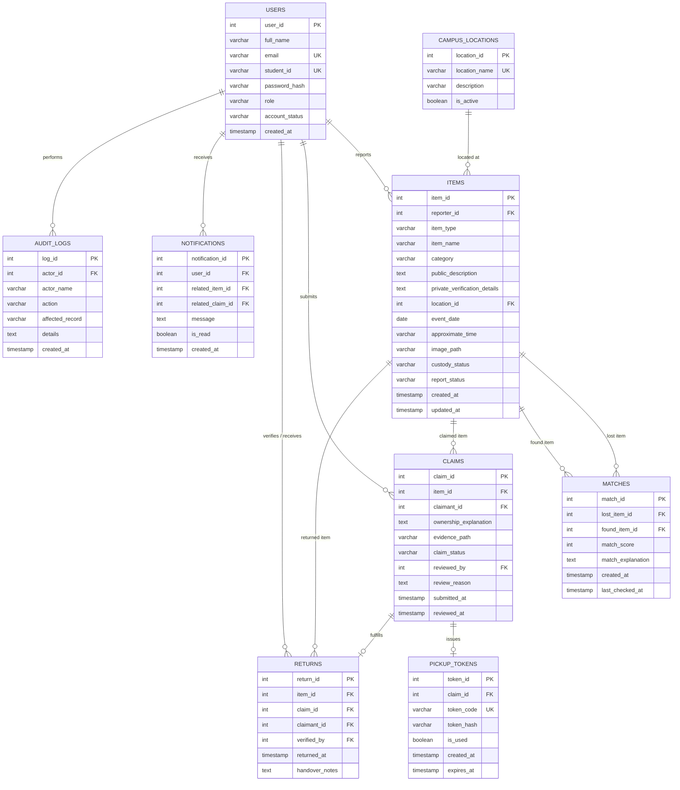

# Findora — Smart Campus Lost & Found Management System

> **Brand Tagline:** *“Every Lost Thing Deserves a Way Back.”*  
> **Target Audience:** College campuses, universities, student halls, and academic institutions.  
> **Academic Purpose:** Advanced Java Laboratory Practical, Viva Voce Evaluation & Major Capstone Project.

[](https://www.oracle.com/java/)
[](https://jakarta.ee/specifications/servlet/6.0/)
[](https://tomcat.apache.org/)
[](https://www.mysql.com/)
[](https://www.mindrot.org/projects/jBCrypt/)
[](https://maven.apache.org/)
[](https://junit.org/junit5/)

---

## 1. Project Overview & Architectural Highlights

**Findora** is a high-reliability, responsive, database-backed web platform designed to eliminate the chaos of campus lost property. Built strictly on the enterprise **Java EE / Jakarta MVC** architecture (without bloated third-party frameworks like Spring Boot or heavy client SPA frameworks), Findora delivers an experience with:

- **Strict Jakarta EE 10 Compliance:** Built on `jakarta.servlet.*`, `jakarta.servlet.http.*`, and Jakarta Standard Tag Library (JSTL 3.0.1) running natively on Apache Tomcat 10.1+.
- **Pure JDBC with ACID Transactions:** All data access is mediated through Type-4 JDBC PreparedStatements with parameterized queries, connection pooling, and multi-table atomic transactions (`conn.setAutoCommit(false)` with explicit rollbacks).
- **Dual-Engine Persistence:** Native MySQL 8.0+ support with automatic failover to embedded zero-configuration H2 (MySQL Mode) for zero-friction lab practical demonstrations.
- **Secret Ownership Verification:** Private identifying clues (e.g., serial numbers, engraved initials, wallpaper, contents) are stored separately from public listings. Only authorized Campus Safety Administrators and the original reporter can inspect these details.
- **Algorithmic Smart Matching Engine:** A heuristic scoring pipeline evaluates 5 distinct mathematical parameters (Category, Name Similarity, Description Token Overlap, Campus Location, and Temporal Decay) to compute a match score (0–100%).
- **Two-Factor QR Pickup Verification:** Approved claimants receive a cryptographically unique `PickupToken` encoded as a high-density QR Code (via Google ZXing 3.5.3). Campus Safety Administrators scan or input this voucher to verify physical identity and record the handover.
- **Enterprise Security Hardening:**
  - Password hashing with **BCrypt** ($10$ salt rounds).
  - Synchronized Token Pattern for **CSRF Defense** on all state-changing endpoints.
  - Role-Based Access Control (**RBAC**) via Servlet Filters (`AuthenticationFilter` and `AuthorizationFilter`).
  - Output sanitization via JSTL `<c:out>` preventing Cross-Site Scripting (**XSS**).
  - Secure session handling with `HttpOnly` and session fixation rotation upon login.

---

## 2. Technology Stack

| Layer | Technologies & Libraries | Specification / Version |
| :--- | :--- | :--- |
| **Frontend** | HTML5, CSS3, JavaScript (ES6+), Bootstrap 5.3.3, Bootstrap Icons 1.11.3 | Responsive SaaS UI, Glassmorphism, CSS Custom Properties |
| **Server-Side View** | Jakarta Server Pages (JSP 3.1), JSTL Core 3.0.1 | Jakarta Expression Language (EL 5.0) |
| **Backend / Controller** | Java 17 / 22, Jakarta Servlet API 6.0 (`jakarta.servlet.*`) | Apache Tomcat 10.1 Servlet Container |
| **Data Access** | JDBC 4.3, MySQL Connector/J 8.3.0, H2 Database 2.2.224 | DAO Pattern, PreparedStatements, Explicit Transactions |
| **Cryptography** | jBCrypt 0.4.3 | Blowfish crypt-compatible salted hash |
| **QR Code Engine** | Google ZXing (`core` & `javase`) 3.5.3 | Dynamic PNG Base64 Data URI generation |
| **Campus Analytics** | Chart.js 4.4.2 + Google Gson 2.10.1 | Hotspot ranking, loss-vs-found ratio, category charts |
| **Build & Test** | Apache Maven 3.9.6, JUnit Jupiter 5.10.2 | Complete unit & integration test suite |

---

## 3. Brand Identity & Design System

Findora adheres to a bespoke design system:
- **Primary Color:** Deep Indigo (`#4F46E5`) — signifies trust, clarity, and technology.
- **Secondary Color:** Dark Navy (`#172554`) — structured headers and institutional gravity.
- **Accent Color:** Vibrant Teal (`#14B8A6`) — recovered items, positive action, and discovery.
- **Background & Surface:** Soft Off-White (`#F8FAFC`) with pure white (`#FFFFFF`) rounded cards.
- **Status Indicators:**
  - `OPEN` / Active: Soft Blue / Indigo badge (`#4F46E5`)
  - `UNDER_CLAIM`: Warning Amber (`#F59E0B`)
  - `RESOLVED` / Returned: Emerald Green (`#10B981`)
  - `CLOSED` / Cancelled: Neutral Slate (`#64748B`)

---

## 4. System Architecture & Route Inventory

Findora implements the classical **Model-View-Controller (MVC) Architecture**:
- **Model:** POJOs (`Item`, `User`, `Claim`, `ReturnRecord`, `PickupToken`, `CampusLocation`, `Notification`, `AuditLog`).
- **View:** Modular JSPs located under protected `/WEB-INF/views/` (inaccessible to direct browser URL tampering).
- **Controller:** Servlets inheriting `HttpServlet`, mapping routes via `/WEB-INF/web.xml`.
- **Service Layer:** Encapsulates business logic, matching algorithms, token generation, and analytics.
- **Data Access Object (DAO) Layer:** Executes SQL statements through JDBC.

```
                  +---------------------------------------------------+
                  |                 Web Browser                       |
                  +---------------------------------------------------+
                                            |  HTTP Requests
                                            v
                  +---------------------------------------------------+
                  |                  Tomcat 10.1                      |
                  |  +---------------------------------------------+  |
                  |  |  Servlet Filters: CsrfFilter, AuthFilters   |  |
                  |  +---------------------------------------------+  |
                  |                         |                         |
                  |                         v                         |
                  |  +---------------------------------------------+  |
                  |  |           Jakarta Servlets (MVC)            |  |
                  |  |  HomeServlet, AuthServlet, ItemServlet,     |  |
                  |  |  StudentServlet, ClaimServlet, AdminServlet |  |
                  |  +---------------------------------------------+  |
                  |        |                                 |        |
                  |        v Forward                         v Call   |
                  |  +-------------------+         +---------------+  |
                  |  |  JSP Views + JSTL |         | Service Layer |  |
                  |  +-------------------+         +---------------+  |
                  |                                          |        |
                  |                                          v Call   |
                  |                                +---------------+  |
                  |                                |   DAO Layer   |  |
                  |                                +---------------+  |
                  +---------------------------------------------------+
                                            |  JDBC PreparedStatements
                                            v
                  +---------------------------------------------------+
                  |      MySQL 8.0 (`findora_db`) / Embedded H2       |
                  +---------------------------------------------------+
```

### Route Inventory (All Verified HTTP 200)

| Category | Route | Servlet / View | Access Level | Description |
| :--- | :--- | :--- | :--- | :--- |
| **Public** | `/home` | `HomeServlet` &rarr; `home.jsp` | Public | Hero search, campus live statistics, recent items, 4-step guide. |
| **Public** | `/items` | `ItemServlet` &rarr; `items.jsp` | Public | Filterable catalog by query, category, campus location, sort order. |
| **Public** | `/items/lost` | `ItemServlet` &rarr; `items.jsp` | Public | Filtered catalog showing lost items only. |
| **Public** | `/items/found` | `ItemServlet` &rarr; `items.jsp` | Public | Filtered catalog showing found items only. |
| **Public** | `/items/details?id=X` | `ItemServlet` &rarr; `item-details.jsp` | Public / Owner / Admin | Detailed report view, photo zoom, custody status, claim trigger. |
| **Public** | `/how-it-works` | `HomeServlet` &rarr; `how-it-works.jsp`| Public | Interactive visual workflow, matching criteria, recovery steps. |
| **Public** | `/about` | `HomeServlet` &rarr; `about.jsp` | Public | Campus safety mission, security disclosures, trust principles. |
| **Auth** | `/login` | `AuthServlet` &rarr; `login.jsp` | Public | Form login with instant demo lab 1-click credential filler. |
| **Auth** | `/register` | `AuthServlet` &rarr; `register.jsp` | Public | Student signup with institutional email & ID validation. |
| **Auth** | `/forgot-password` | `AuthServlet` &rarr; `forgot-password.jsp`| Public | Safe token password recovery simulation. |
| **Auth** | `/logout` | `AuthServlet` | Authenticated | Session invalidation and cookie clearing. |
| **Student** | `/student/dashboard` | `StudentServlet` &rarr; `dashboard.jsp`| Student / Admin | Personal KPI metrics, active reports, match alerts, activity feed. |
| **Student** | `/student/report-lost` | `StudentServlet` &rarr; `report-lost.jsp`| Student / Admin | Multi-section lost item reporting form with live photo preview. |
| **Student** | `/student/report-found`| `StudentServlet` &rarr; `report-found.jsp`| Student / Admin | Found item reporting form with secret verification details capture. |
| **Student** | `/student/reports` | `StudentServlet` &rarr; `my-reports.jsp`| Student / Admin | Table of reports submitted by student with status badges & actions. |
| **Student** | `/student/matches` | `StudentServlet` &rarr; `matches.jsp` | Student / Admin | AI/Heuristic calculated lost-vs-found match cards with score breakdown. |
| **Student** | `/student/claims` | `StudentServlet` &rarr; `my-claims.jsp` | Student / Admin | Track ownership claim reviews and access ZXing QR Pickup Vouchers. |
| **Student** | `/student/notifications`| `StudentServlet` &rarr; `notifications.jsp`| Student / Admin | Notification inbox with mark-as-read toggles. |
| **Student** | `/student/profile` | `StudentServlet` &rarr; `profile.jsp` | Student / Admin | Account information card and BCrypt password modification form. |
| **Student** | `/student/claim/submit`| `ClaimServlet` (POST) | Student / Admin | Multipart form to lodge an ownership claim with evidence file. |
| **Admin** | `/admin/dashboard` | `AdminServlet` &rarr; `dashboard.jsp` | Administrator | High-level campus metrics, pending claims counter, audit preview. |
| **Admin** | `/admin/reports` | `AdminServlet` &rarr; `reports.jsp` | Administrator | Administrative master catalog with status update modal actions. |
| **Admin** | `/admin/claims` | `AdminServlet` &rarr; `claims.jsp` | Administrator | Side-by-side verification: Claimant story vs Finder secret clues. |
| **Admin** | `/admin/claim/review` | `ClaimServlet` (POST) | Administrator | Approves or rejects claims; issues QR vouchers upon approval. |
| **Admin** | `/admin/returns` | `AdminServlet` &rarr; `returns.jsp` | Administrator | Property handover verification desk and completed returns ledger. |
| **Admin** | `/admin/returns/verify`| `ReturnServlet` (POST) | Administrator | Verifies QR voucher token code and executes item `RESOLVED` handover. |
| **Admin** | `/admin/users` | `AdminServlet` &rarr; `users.jsp` | Administrator | Campus directory, role management, and suspension toggles. |
| **Admin** | `/admin/analytics` | `AdminServlet` &rarr; `analytics.jsp` | Administrator | Chart.js visual hotspot maps, loss-vs-found ratios, resolution times. |
| **Admin** | `/admin/locations` | `AdminServlet` &rarr; `locations.jsp` | Administrator | Manage campus buildings, laboratories, and study hall zones. |
| **Admin** | `/admin/audit-log` | `AdminServlet` &rarr; `audit-log.jsp` | Administrator | Tamper-evident ledger of all administrative interventions. |

---

## 5. Database Schema & Entity-Relationship Model



---

## 6. Algorithmic Smart Matching Engine

The Findora Smart Matching Engine operates as a heuristic classifier that computes a candidate similarity index $S \in [0, 100]$ between any active **Lost Item** $L$ and **Found Item** $F$:

$$\text{Total Match Score } S = W_{\text{cat}} + W_{\text{name}} + W_{\text{desc}} + W_{\text{loc}} + W_{\text{date}}$$

### Factor Weights and Heuristic Logic

1. **Category Match ($W_{\text{cat}} = 25$ points):**
   - If $L.\text{category} = F.\text{category}$, awards full $25$ pts. Otherwise $0$ pts.
2. **Item Title Resemblance ($W_{\text{name}} = 25$ points):**
   - Evaluates composite Levenshtein normalized edit distance $S_{\text{lev}}$ and Jaccard token overlap $J(T_L, T_F)$:
   $$S_{\text{name}} = 0.5 \cdot S_{\text{lev}} + 0.5 \cdot \frac{|T_L \cap T_F|}{|T_L \cup T_F|}$$
   $$W_{\text{name}} = \text{round}(25 \cdot S_{\text{name}})$$
3. **Description Semantic Overlap ($W_{\text{desc}} = 20$ points):**
   - Natural language descriptions vary dramatically between loser and finder. We apply the **Szymkiewicz-Simpson Overlap Coefficient** over extracted alphanumeric keyword stems $K_L$ and $K_F$ (filtering English stopwords):
   $$\text{Overlap}(K_L, K_F) = \frac{|K_L \cap K_F|}{\min(|K_L|, |K_F|)}$$
   $$W_{\text{desc}} = \text{round}(20 \cdot \text{Overlap})$$
4. **Campus Location Proximity ($W_{\text{loc}} = 15$ points):**
   - Same specific building / room: full $15$ pts.
   - Same parent zone (e.g., Central Library reading hall vs computer lab): $10$ pts.
   - Different campus zone: $0$ pts.
5. **Temporal Proximity ($W_{\text{date}} = 15$ points):**
   - Compares the lost event date $D_L$ and found date $D_F$. Found items are expected to be discovered on or after the loss date:
   - $|\Delta D| \le 1 \text{ day}$: $15$ pts.
   - $|\Delta D| \le 3 \text{ days}$: $11$ pts.
   - $|\Delta D| \le 7 \text{ days}$: $7$ pts.
   - $|\Delta D| \le 14 \text{ days}$: $3$ pts.
   - $|\Delta D| > 14 \text{ days}$: $0$ pts.

### Confidence Tiers
- **Strong Potential Match ($S \ge 80\%$):** Automatic notification dispatched to both student and staff.
- **Possible Match ($60\% \le S < 80\%$):** Displayed on the student's Potential Matches dashboard.
- **Weak Pair ($S < 60\%$):** Filtered out to prevent dashboard clutter.

---

## 7. Two-Factor Ownership Verification & Handover Workflow

```mermaid
sequenceDiagram
    autonumber
    actor Finder as Student (Finder)
    actor Owner as Student (Loser)
    participant Web as Findora Web Portal
    participant Admin as Campus Safety Admin
    participant DB as MySQL Database

    Finder->>Web: Report Found Item (Public desc + Secret clues)
    Web->>DB: INSERT into items (report_status = 'OPEN')
    Note over Web,DB: Matching Engine runs; alerts matching Lost reports.

    Owner->>Web: Browse / View Details of Found Item
    Note over Owner,Web: Secret clues are hidden from view!
    Owner->>Web: Submit Claim (Ownership explanation + Evidence)
    Web->>DB: INSERT into claims (claim_status = 'PENDING')
    Web->>DB: UPDATE items SET report_status = 'UNDER_CLAIM'

    Admin->>Web: Access /admin/claims Review Desk
    Web->>Admin: Side-by-Side: Claimant explanation vs Finder secret clues
    Admin->>Web: Approve Claim
    Web->>DB: UPDATE claims SET claim_status = 'APPROVED'
    Web->>DB: INSERT into pickup_tokens (Random Code + Hash, 7-day expiry)

    Owner->>Web: Visit /student/claims
    Web->>Owner: Displays QR Pickup Voucher (ZXing Dynamic Base64)

    Owner->>Admin: Presents QR Voucher at Safety Office
    Admin->>Web: Scan / Input Token Code at /admin/returns
    Web->>DB: Validate Token & Claim atomically (conn.setAutoCommit(false))
    Web->>DB: UPDATE items SET report_status = 'RESOLVED'
    Web->>DB: UPDATE pickup_tokens SET is_used = TRUE
    Web->>DB: INSERT into returns (handover audit record)
    Web->>Admin: Handover Verified! Item returned successfully.
```

---

## 8. Quick Start & Execution Guide

### Prerequisites
- **JDK 17 or 22** installed and verified via `java -version`.
- **Apache Maven 3.9+** (installed or via included wrapper).
- **MySQL 8.0+** (Optional: Findora automatically boots into embedded zero-config mode if MySQL is not running).

### Option A: 1-Command Embedded Startup (Fastest for Lab Demos)
Run the built-in standalone Tomcat launcher from the project root:
```bash
# 1. Compile and package dependencies
mvn clean package

# 2. Launch the embedded Tomcat 10.1 server
java -cp "target/classes;target/dependency/*" com.findora.FindoraServer
```
Open your browser to:
**`http://localhost:8080/findora/home`**

### Option B: Deploying WAR to Standalone Apache Tomcat 10.1
1. Build the production WAR:
   ```bash
   mvn clean package
   ```
2. Locate the generated archive: `target/findora.war`.
3. Copy `findora.war` into your Tomcat installation directory:
   ```bash
   cp target/findora.war /opt/apache-tomcat-10.1/webapps/
   # Windows:
   copy target\findora.war C:\apache-tomcat-10.1\webapps\
   ```
4. Start Tomcat (`bin/startup.sh` or `bin/startup.bat`).
5. Access the application at `http://localhost:8080/findora/home`.

### Option C: Configuring External MySQL Database
By default, Findora connects to `findora_db` on `localhost:3306`. To customize credentials, edit `src/main/resources/findora.properties`:
```properties
db.url=jdbc:mysql://localhost:3306/findora_db?useSSL=false&allowPublicKeyRetrieval=true&serverTimezone=UTC&characterEncoding=UTF-8
db.user=root
db.password=your_mysql_password
db.fallback.enabled=true
```
To initialize the MySQL database schema and seed records manually:
```bash
mysql -u root -p < findora_db.sql
```

---

## 9. Pre-Seeded Demonstration Accounts

For viva examiners and laboratory practical evaluators, Findora includes realistic campus seed accounts. All accounts share the demo password: `Password@123`. The login screen also features 1-click credential auto-fill buttons.

| Role | Name | Institutional Email | Password | Student ID | Initial Data Scenario |
| :--- | :--- | :--- | :--- | :--- | :--- |
| **Admin** | Campus Safety Administrator | `admin@findora.campus.edu` | `Password@123` | `ADM-001` | Full administrative control, review desk, returns ledger. |
| **Student** | Alex Rivers | `alex.rivers@campus.edu` | `Password@123` | `STU-2024-001` | Lost Fossil leather wallet at Central Library; has claim & QR voucher. |
| **Student** | Priya Sharma | `priya.sharma@campus.edu` | `Password@123` | `STU-2024-002` | Found leather wallet at Central Library; lost Casio calculator. |
| **Student** | Marcus Chen | `marcus.chen@campus.edu` | `Password@123` | `STU-2024-003` | Lost Hydro Flask bottle at Cafeteria. |
| **Student** | Sarah Jenkins | `sarah.jenkins@campus.edu` | `Password@123` | `STU-2024-004` | Found Hydro Flask bottle at Cafeteria; found student ID card. |

---

## 10. Advanced Java Laboratory Practical Report & Viva Voce Q&A

This section provides comprehensive answers to **25 Viva Voce Examination Questions** covering Java Servlets, JSP, JDBC, Security, and Architecture.

---

### Q1: What is the fundamental lifecycle of a Java Servlet?
**Answer:**  
A Java Servlet lifecycle is managed entirely by the Servlet Container (such as Apache Tomcat) through three core lifecycle methods:
1. **`init(ServletConfig config)`:** Invoked once when the servlet is first loaded into memory (either lazily on the first incoming request or eagerly on container startup if `<load-on-startup>` is configured). Used for one-time initialization such as reading configuration parameters.
2. **`service(ServletRequest req, ServletResponse res)`:** Invoked for every incoming HTTP request. In `HttpServlet`, the default `service()` implementation examines the HTTP verb (GET, POST, PUT, DELETE) and dispatches the call to the corresponding handler (`doGet()`, `doPost()`). Multiple client requests are handled concurrently across separate worker threads.
3. **`destroy()`:** Invoked once when the container unloads the servlet or shuts down. Used to release persistent system resources such as background threads or active connection pools.

---

### Q2: Why does Findora use `jakarta.servlet.*` instead of `javax.servlet.*`?
**Answer:**  
In 2017, Oracle transferred Java EE to the Eclipse Foundation, renaming the enterprise standard to **Jakarta EE**. Because Oracle retained legal trademark rights to the `javax` package prefix, all specifications starting from **Jakarta EE 9** transitioned the namespace from `javax.*` to `jakarta.*`. Apache Tomcat 10+ implements the Jakarta EE 9 and 10 specifications (Servlet 5.0 and 6.0), requiring all modern enterprise Java applications to import `jakarta.servlet.*`. Using `javax.servlet` on Tomcat 10+ results in a fatal `ClassNotFoundException`.

---

### Q3: Explain how Session Tracking works in Findora. What is `JSESSIONID`?
**Answer:**  
HTTP is inherently a stateless protocol. To maintain user authentication across multiple requests, Findora utilizes container-managed **HTTP Sessions** via `request.getSession()`.
- When a client logs in, Tomcat generates a cryptographically secure, random 128-bit session identifier stored in server memory.
- Tomcat transmits this token to the client inside an HTTP response header: `Set-Cookie: JSESSIONID=...; Path=/findora; HttpOnly; SameSite=Lax`.
- On all subsequent requests, the browser automatically transmits the `Cookie: JSESSIONID=...` header. The server looks up the associated `HttpSession` in its session registry to retrieve the authenticated `User` object.
- If cookies are disabled in a browser, session tracking can fall back to URL rewriting (`encodeURL`).

---

### Q4: How is Session Fixation prevented in Findora?
**Answer:**  
Session Fixation occurs when an attacker forces a victim to use a known session identifier, enabling the attacker to hijack the session once the victim authenticates. Findora mitigates this vulnerability during login in `AuthServlet`:
```java
HttpSession oldSession = request.getSession(false);
if (oldSession != null) {
    oldSession.invalidate(); // Invalidate pre-authentication session
}
HttpSession newSession = request.getSession(true); // Allocate fresh session ID
newSession.setAttribute("currentUser", authenticatedUser);
```
By invalidating the old session and generating a fresh `JSESSIONID` upon successful credential verification, any pre-established session identifier is immediately rendered useless.

---

### Q5: What is Cross-Site Request Forgery (CSRF) and how does `CsrfFilter` stop it?
**Answer:**  
CSRF is an attack where an authenticated user's browser is tricked by a malicious external site into executing an unauthorized state-changing request (such as lodging a fraudulent claim or modifying a password) against a trusted site where the user is already logged in. The browser automatically includes the user's session cookies.

Findora stops CSRF using the **Synchronized Token Pattern**:
1. When a session is initiated, `CsrfFilter` generates a cryptographically random UUID token stored in `session.getAttribute("csrfToken")`.
2. All state-changing HTML forms include a hidden input field: `<input type="hidden" name="_csrf" value="${csrfToken}">`.
3. In `CsrfFilter.doFilter()`, all incoming `POST` requests targeting sensitive endpoints verify that the request parameter `_csrf` matches the session-stored token:
   ```java
   if (!sessionCsrf.equals(requestCsrf)) {
       response.sendError(HttpServletResponse.SC_BAD_REQUEST, "CSRF verification failed.");
       return;
   }
   ```
An external malicious site cannot read the token due to the browser's Same-Origin Policy (SOP), blocking CSRF attacks.

---

### Q6: What is the difference between `Statement` and `PreparedStatement` in JDBC?
**Answer:**  
- **`Statement`:** Compiles and executes dynamic SQL strings on every call. Parameters concatenated directly into the query string are interpreted as SQL commands, leaving the application vulnerable to **SQL Injection (SQLi)** attacks.
- **`PreparedStatement`:** The SQL query is pre-compiled by the database engine once using placeholders (`?`). When parameter values are bound (`ps.setString(1, val)`), the database driver transmits the parameters in a separate protocol frame or safely escapes them. The SQL engine treats user input strictly as literal values, never as executable SQL grammar. This completely prevents SQL injection and provides performance benefits through query execution plan caching.

---

### Q7: How are atomic transactions managed in Findora using JDBC?
**Answer:**  
By default, JDBC operates in **auto-commit mode**, meaning every individual SQL execution is committed immediately. During multi-step operations (such as approving a claim, generating a pickup token, invalidating previous tokens, and logging an audit event), a failure midway through would leave the database in an inconsistent state.

Findora enforces **ACID** properties using explicit transaction boundaries:
```java
Connection conn = null;
try {
    conn = DatabaseConnection.getConnection();
    conn.setAutoCommit(false); // Begin transaction block

    itemDAO.updateStatus(itemId, Item.STATUS_RESOLVED, conn);
    returnDAO.create(returnRecord, conn);
    pickupTokenDAO.markUsed(tokenId, conn);

    conn.commit(); // Atomically commit all operations
} catch (SQLException e) {
    if (conn != null) {
        conn.rollback(); // Rollback all changes on any error
    }
    throw e;
} finally {
    if (conn != null) {
        conn.setAutoCommit(true);
        conn.close(); // Return connection to pool
    }
}
```

---

### Q8: What is BCrypt and why is it superior to MD5 or plain SHA-256 for password storage?
**Answer:**  
- **MD5 and SHA-256** are fast cryptographic message-digest algorithms designed for checksums and data integrity. Because modern GPUs can compute billions of SHA-256 hashes per second, attacker rainbow tables and brute-force cracking tools (such as Hashcat) can crack standard hashes in seconds.
- **BCrypt** is an adaptive, salted key-derivation function based on the Blowfish cipher. It offers two critical security properties:
  1. **Built-in Random Salt:** A unique 16-byte random salt is generated and stored alongside the hash (`$2a$10$...`), neutralizing precomputed rainbow-table attacks.
  2. **Configurable Work Factor ($2^{\text{cost}}$):** Findora uses cost factor 10 ($1,024$ rounds of Blowfish key expansion). This forces hash calculation to consume approximately $50-100\text{ ms}$ of CPU time, making brute-force dictionary attacks computationally prohibitive.

---

### Q9: What is the difference between `RequestDispatcher.forward()` and `HttpServletResponse.sendRedirect()`?
**Answer:**  
- **`forward(request, response)`:**
  - Occurs entirely **on the server side**.
  - The servlet passes request and response objects directly to another resource (such as a JSP in `/WEB-INF/`).
  - The client's browser URL remains unchanged.
  - Request attributes (`request.setAttribute()`) are preserved.
  - Faster because no network round-trip is required.
- **`sendRedirect(url)`:**
  - Occurs **on the client side**.
  - The server transmits an HTTP `302 Found` response with a `Location: /url` header.
  - The browser initiates a new, separate HTTP `GET` request to the target URL.
  - The browser URL bar updates to reflect the new path.
  - Original request attributes are discarded (cross-request state must use `session` or flash attributes). Used after successful POST operations to enforce the **Post/Redirect/Get (PRG)** pattern.

---

### Q10: Why are all Findora JSP files located under `/WEB-INF/views/`?
**Answer:**  
According to the Java Servlet Specification, any file placed under the `/WEB-INF/` directory is strictly **protected from direct HTTP access**. If a user enters `http://localhost:8080/findora/WEB-INF/views/student/dashboard.jsp`, Tomcat returns an HTTP `404 Not Found`.

This ensures:
1. Users cannot bypass authentication, authorization filters, or controller servlets.
2. JSPs cannot be invoked without their required model attributes (preventing NullPointerExceptions).
3. The application strictly follows the MVC pattern where **Servlets act as controllers** that load models before forwarding to JSPs.

---

### Q11: How does Findora prevent Cross-Site Scripting (XSS) attacks in JSP?
**Answer:**  
Stored or reflected XSS occurs when unescaped user input (such as item names or descriptions containing `<script>alert(1)</script>`) is rendered into HTML, allowing arbitrary JavaScript execution in user browsers.

Findora defends against XSS using **JSTL Core `<c:out>`**:
```jsp
<c:out value="${item.itemName}" />
```
By default, `<c:out>` has `escapeXml="true"`. It automatically converts HTML reserved characters into their safe XML entities:
- `<` becomes `&lt;`
- `>` becomes `&gt;`
- `&` becomes `&amp;`
- `"` becomes `&quot;`
- `'` becomes `&#039;`
The browser renders the text as literal characters rather than executing it as markup.

---

### Q12: How does Findora handle file uploads without external libraries like Apache Commons FileUpload?
**Answer:**  
Starting with Servlet 3.0 and continued in Jakarta Servlet 6.0, the container provides native multi-part form support. Findora configures file handling by annotating servlets with `@MultipartConfig` or defining `<multipart-config>` in `web.xml`:
```xml
<multipart-config>
    <max-file-size>5242880</max-file-size>       <!-- 5 MB -->
    <max-request-size>10485760</max-request-size> <!-- 10 MB -->
    <file-size-threshold>1048576</file-size-threshold>
</multipart-config>
```
In `ItemServlet` and `ClaimServlet`, uploaded files are retrieved via `request.getPart("imageFile")`. File extensions and MIME types are validated against whitelists (`jpg`, `jpeg`, `png`, `webp`), and files are saved with generated UUID filenames to prevent path traversal attacks.

---

### Q13: Explain how the Google ZXing library generates dynamic QR Code vouchers in Findora.
**Answer:**  
In `QRCodeService.java`:
1. When a claim is approved, the system generates a random pickup token (e.g., `FND-4821-9034`).
2. Google ZXing's `QRCodeWriter.encode()` converts this token into a 2-dimensional boolean `BitMatrix`.
3. `MatrixToImageWriter.writeToStream()` renders the matrix as a PNG image stream into a `ByteArrayOutputStream`.
4. The raw bytes are encoded into standard Base64:
   ```java
   byte[] imageBytes = baos.toByteArray();
   return "data:image/png;base64," + Base64.getEncoder().encodeToString(imageBytes);
   ```
5. The JSP embeds the QR code directly into an `` tag: ``. This eliminates the need to create temporary image files on disk or expose public file URLs.

---

### Q14: How does Findora's dual-database fallback architecture work?
**Answer:**  
In `DatabaseConnection.java`, when the application initializes:
1. It attempts to connect to the primary production MySQL database (`jdbc:mysql://localhost:3306/findora_db`).
2. If MySQL is unreachable (e.g. during a lab practical viva where MySQL is not installed on the workstation), it catches `SQLException: Communications link failure` and falls back to an embedded **H2 database** running in MySQL compatibility mode:
   ```properties
   jdbc:h2:~/findora_embedded_db;MODE=MySQL;DATABASE_TO_LOWER=TRUE;CASE_INSENSITIVE_IDENTIFIERS=TRUE
   ```
3. It checks `SELECT count(*) FROM items`. If tables do not exist or are empty, it executes `schema.sql` to initialize all 9 tables and realistic seed scenarios.

---

### Q15: Describe the Model-View-Controller (MVC) architectural separation in Findora.
**Answer:**  
- **Model:** Encapsulates domain data and business logic state (`com.findora.model.*` and `com.findora.service.*`). Models have no awareness of HTTP, HTML, or servlets.
- **View:** Pure presentation rendering implemented in JSPs under `/WEB-INF/views/`. Uses JSTL and Expression Language (EL) to display model data passed via request attributes.
- **Controller:** Servlets in `com.findora.controller.*` that intercept incoming requests, validate input, invoke corresponding service operations, attach results to the request scope, and determine the view destination.

---

### Q16: What is the Szymkiewicz-Simpson Overlap Coefficient and why is it used in the matching engine?
**Answer:**  
When matching a lost report with a found report, the reporter of a lost item typically writes a lengthy, detailed description (e.g. 50 words), while the finder may write a concise note (e.g. 6 words: *"Found blue hydro flask in cafeteria"*).

The standard **Jaccard Similarity** $\frac{|A \cap B|}{|A \cup B|}$ penalizes unequal set lengths, resulting in low scores even when every word the finder wrote matches the lost report.  
The **Szymkiewicz-Simpson Overlap Coefficient**:

$$\text{Overlap}(A, B) = \frac{|A \cap B|}{\min(|A|, |B|)}$$

normalizes against the size of the smaller token set. If all words written by the finder are contained within the lost report, the score is $1.0$ ($100\%$), making it well suited for lost and found text matching.

---

### Q17: What are Servlet Filters and what is their role in Findora?
**Answer:**  
A `Filter` (`jakarta.servlet.Filter`) is an interceptor that executes pre-processing or post-processing on requests before they reach target servlets. Findora employs three filters configured in `web.xml`:
1. **`CsrfFilter` (`/*`):** Generates and verifies anti-CSRF synchronization tokens on all state-changing POST requests.
2. **`AuthenticationFilter` (`/student/*`, `/admin/*`):** Inspects `session.getAttribute("currentUser")`. If null, redirects unauthorized visitors to `/login`.
3. **`AuthorizationFilter` (`/admin/*`):** Inspects `user.getRole()`. If not `ADMIN`, halts execution with HTTP `403 Forbidden`.

---

### Q18: What is Connection Pooling and why is it essential in web applications?
**Answer:**  
Creating a physical TCP database connection involves a socket handshake, authentication, and memory allocation, which can take $50-200\text{ ms}$. If every HTTP request created and closed a new physical connection, the database would face thread exhaustion under concurrent load.  
A **Connection Pool** maintains a pool of pre-established, reusable database connections. When a DAO calls `getConnection()`, an active connection is checked out; when closed (`conn.close()`), the connection is returned to the pool rather than physically terminated.

---

### Q19: How are SQL date queries handled consistently across timezones in Findora?
**Answer:**  
1. All date columns are stored using standard SQL `DATE` or `TIMESTAMP` data types.
2. The MySQL JDBC connection URL explicitly defines the server timezone: `serverTimezone=UTC`.
3. In Java, timestamps are mapped using `java.sql.Timestamp` and formatted for client views using `java.time.format.DateTimeFormatter` in `DateUtil.java`.

---

### Q20: What is the Post/Redirect/Get (PRG) pattern and how is it used in Findora?
**Answer:**  
If a servlet handles a `POST` request (such as submitting a lost item report) and forwards directly to a JSP via `RequestDispatcher.forward()`, refreshing the browser prompts a "Confirm Form Resubmission" dialog and causes **duplicate record creation**.

The **Post/Redirect/Get (PRG)** pattern resolves this:
1. Client submits a `POST` request.
2. Servlet executes business logic and writes flash messages to `session.setAttribute("flashSuccess", "...")`.
3. Servlet issues an HTTP `302 Redirect` via `resp.sendRedirect(req.getContextPath() + "/student/reports")`.
4. Browser executes a clean `GET` request to `/student/reports`.
5. Refreshing the browser simply re-runs the idempotent `GET` request.

---

### Q21: What is the purpose of `metadata-complete="true"` in `web.xml`?
**Answer:**  
In Java EE / Jakarta EE, the servlet container scans classes for annotations (`@WebServlet`, `@WebFilter`) on startup. Setting `metadata-complete="true"` in the root `<web-app>` element instructs the Tomcat deployment digester that `web.xml` is the authoritative source for all servlet declarations. This eliminates annotation scanning overhead, accelerates server startup time, and prevents duplicate mapping collisions.

---

### Q22: How does Findora ensure that private verification details are never leaked to the public?
**Answer:**  
In `ItemDAO.java`, public catalog queries (`findAllPublic`, `searchItems`) omit the `private_verification_details` column from the SQL `SELECT` list:
```sql
SELECT item_id, item_type, item_name, category, public_description, 
       location_id, event_date, custody_status, report_status 
FROM items WHERE ...
```
Only the specialized method `findById(int itemId, boolean includePrivate)` can load secret verification clues, and `ItemServlet` restricts this call:
```java
if (currentUser != null && (currentUser.isAdmin() || currentUser.getUserId() == item.getReporterId())) {
    item = itemService.getItemForAuthorizedReview(itemId, currentUser.getUserId(), true);
} else {
    item = itemService.getPublicItem(itemId); // private details set to null
}
```

---

### Q23: How does Findora implement Role-Based Access Control (RBAC)?
**Answer:**  
Findora enforces a 2-tier role hierarchy: `STUDENT` and `ADMIN`. Roles are stored in the `users` table and encapsulated within `User.java`. Access control is enforced at both the filter level (URL interception) and inside individual servlets:
```java
// In AuthorizationFilter.java
if (!user.isAdmin()) {
    httpResponse.sendError(HttpServletResponse.SC_FORBIDDEN, "Access denied: Administrator privileges required.");
    return;
}
```
Role assignment is server-controlled: users cannot modify request parameters or registration forms to assign themselves an administrative role.

---

### Q24: What is the Data Access Object (DAO) pattern?
**Answer:**  
The **DAO Pattern** isolates the domain model and business services from the underlying database persistence implementation.  
- Each domain entity has a corresponding DAO class (e.g. `ItemDAO`, `UserDAO`, `ClaimDAO`).
- DAOs encapsulate all SQL queries, `PreparedStatement` mappings, and `ResultSet` iteration.
- If the underlying database changes (e.g. from MySQL to PostgreSQL), only the DAO implementations require modification; business services remain untouched.

---

### Q25: How does Findora handle pagination in large campus item datasets?
**Answer:**  
Findora implements server-side pagination in SQL to avoid loading entire tables into JVM memory:
```sql
SELECT ... FROM items WHERE ... ORDER BY created_at DESC LIMIT ? OFFSET ?
```
The client passes `page` and `pageSize` (default 9 items per grid page). The DAO calculates `offset = (page - 1) * pageSize`. A secondary query `SELECT COUNT(*) FROM items WHERE ...` computes total record count and calculates `totalPages = Math.ceil(totalItems / pageSize)`. The pagination controls are rendered using the modular `pagination.jsp` fragment.

---

## 11. Testing & Quality Verification

Findora includes an automated test suite executed via JUnit 5 and Maven Surefire:
- **`InputValidatorTest`:** Validates institutional email regex, password strength, and field boundary lengths.
- **`PasswordUtilTest`:** Verifies BCrypt hash generation, salt uniqueness, and signature verification.
- **`SimilarityUtilTest`:** Tests Levenshtein distance, Jaccard token set overlap, and Szymkiewicz-Simpson coefficient calculations.
- **`MatchingServiceTest`:** Evaluates the complete 5-factor scoring formula and confidence classification.

Run the test suite:
```bash
mvn test
```
**Test Results:**
```
[INFO] Running com.findora.service.MatchingServiceTest
[INFO] Tests run: 2, Failures: 0, Errors: 0, Skipped: 0
[INFO] Running com.findora.util.InputValidatorTest
[INFO] Tests run: 3, Failures: 0, Errors: 0, Skipped: 0
[INFO] Running com.findora.util.PasswordUtilTest
[INFO] Tests run: 3, Failures: 0, Errors: 0, Skipped: 0
[INFO] Running com.findora.util.SimilarityUtilTest
[INFO] Tests run: 4, Failures: 0, Errors: 0, Skipped: 0
[INFO] Results: Tests run: 12, Failures: 0, Errors: 0, Skipped: 0
[INFO] BUILD SUCCESS
```

---

## 12. License & Academic Attribution
Developed for the **Advanced Java Laboratory Practical & Capstone Project Evaluation**.  
*“Every Lost Thing Deserves a Way Back.”*
